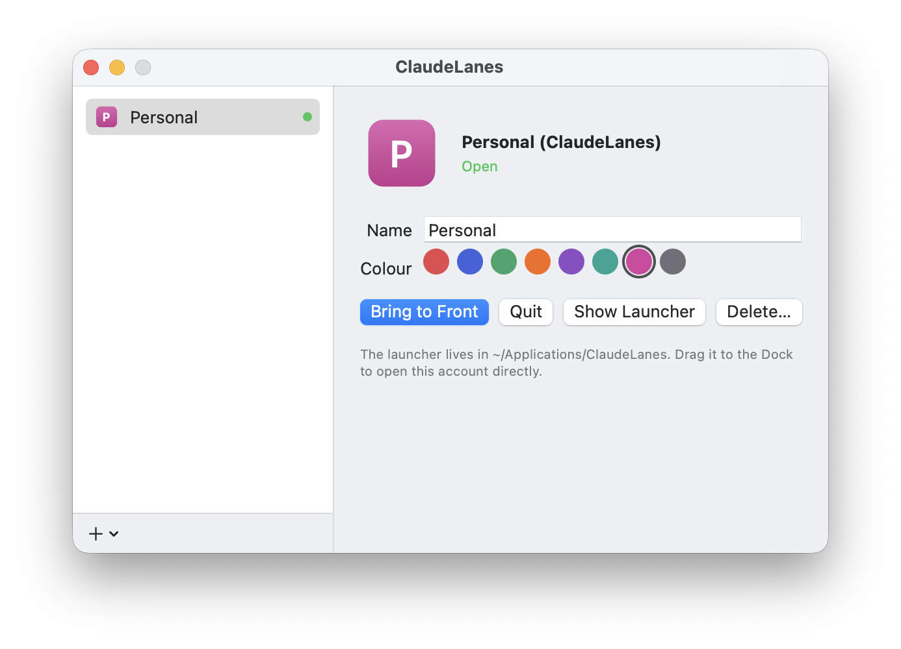

# ClaudeLanes

Run several Claude desktop accounts side by side on your Mac — work and personal, each in
its own window, at the same time. Free and open source.

*[Español más abajo](#español)*

<p align="center"></p>

> ClaudeLanes is an independent, unofficial project. It is not made by, affiliated with or
> endorsed by Anthropic. "Claude" is a trademark of Anthropic. ClaudeLanes is for using your own
> legitimate accounts, not for sharing credentials.

## How it works

The official Claude app keeps one account signed in. ClaudeLanes starts extra instances of the
**unmodified** Claude app you installed, each with its own data folder (`--user-data-dir`), so
every profile keeps its own sign-in, settings and history. ClaudeLanes never changes, copies or
re-signs Claude, and your normal Claude stays as it is.

- **Menu bar app** — open, bring to front or quit each profile, and see which ones are running.
- **Window labels** — a small pill with the profile colour and name sits at the top of each
  profile's window, so you always know which account you are in. Turn it off from the menu.
- **One launcher per profile** — `~/Applications/ClaudeLanes/<Name> (ClaudeLanes).app`, with a
  coloured icon and the profile initials. Find it with Spotlight or Launchpad, or drag it to the
  Dock. It works even when ClaudeLanes is not running.
- **Import your current Claude** — turn the account you already use into a profile, with its
  sign-in, settings and history. The original stays untouched as a backup.
- **No duplicates** — opening a profile that is already running brings its window to the front
  instead of starting a second process on the same data, which could corrupt it.
- **Open at login** — optional.

## Install

With [Homebrew](https://brew.sh):

```sh
brew trust --cask xexuscode/tap/claudelanes   # Homebrew 7+ asks you to trust third-party casks once
brew install --cask xexuscode/tap/claudelanes
```

Or download `ClaudeLanes-x.y.z.zip` from
[Releases](https://github.com/XexusCode/claudelanes/releases) and move `ClaudeLanes.app` to
`/Applications`.

The app is not notarized by Apple, so the first time macOS blocks it. Open it once, then go to
**System Settings → Privacy & Security** and click **Open Anyway**. If you prefer, build it
yourself from source (below).

Requires macOS 14 or later and [Claude for Mac](https://claude.ai/download).

## Use

1. Open ClaudeLanes. The profiles window appears.
2. Click **+ → New Profile**, name it, pick a colour, click **Open** and sign in with that
   account. Or click **+ → Import from Current Claude…** to turn the account you already use into
   a profile (quit Claude first).
3. Open profiles from the menu bar icon, from the window, or from their launchers in Spotlight.

## Build from source

Needs the Xcode Command Line Tools (`xcode-select --install`); full Xcode is not required.

```sh
make test      # unit tests
make install   # builds dist/ClaudeLanes.app and copies it to /Applications
make zip       # dist/ClaudeLanes-<version>.zip for a release
```

## Where things are

| What | Where |
| --- | --- |
| Profile list | `~/Library/Application Support/ClaudeLanes/profiles.json` |
| Profile data (sign-in, settings, history) | `~/Library/Application Support/ClaudeLanes/Profiles/<id>/` |
| Launchers | `~/Applications/ClaudeLanes/` |

Deleting a profile removes its launcher. Its data is kept unless you tick
"Also move its session data to the Trash". Profiles from the earlier "Lanes" version are moved
here automatically.

## Known limitations

- **Dock and ⌘-Tab.** Every open profile shows as "Claude" with Claude's icon, because that is
  the app that is running. Use the window labels or the ClaudeLanes menu to tell them apart.
- **Links.** `claude://` links from the browser open in whichever Claude instance macOS picks.
- If a Claude update changes how `--user-data-dir` works, ClaudeLanes may need an update.

## Licence

MIT

---

## Español

Usa varias cuentas de Claude a la vez en tu Mac, por ejemplo trabajo y personal, cada una en su
ventana. Gratis y de código abierto. Proyecto independiente y no oficial, sin relación con
Anthropic. Es para usar tus propias cuentas legítimas, no para compartir credenciales.

**Cómo funciona:** ClaudeLanes abre la app oficial de Claude **sin modificar** varias veces, cada
una con su propia carpeta de datos, así que cada perfil guarda aparte su sesión, ajustes e
historial. No cambia, copia ni vuelve a firmar Claude, y tu Claude normal no se toca.

- Menú en la barra superior para abrir, traer al frente o cerrar cada perfil.
- Etiqueta con el color y el nombre del perfil en la parte superior de su ventana.
- Un lanzador por perfil en `~/Applications/ClaudeLanes/`, con icono de color e iniciales. Sale
  en Spotlight y Launchpad, y lo puedes anclar al Dock.
- Importar tu Claude actual como perfil, con su sesión, ajustes e historial. El original se
  queda intacto como copia de seguridad.
- Si el perfil ya está abierto, lo trae al frente en vez de abrir otro encima de los mismos datos.

**Instalar:** `brew trust --cask xexuscode/tap/claudelanes` y luego
`brew install --cask xexuscode/tap/claudelanes`, o descarga el zip de *Releases* y
mueve `ClaudeLanes.app` a Aplicaciones. La app no está notarizada: la primera vez ábrela, ve a
**Ajustes del Sistema → Privacidad y seguridad** y pulsa **Abrir igualmente**.

**Limitación:** en el Dock y en ⌘-Tab todos los perfiles abiertos salen como «Claude». Usa las
etiquetas de las ventanas o el menú de ClaudeLanes para distinguirlos.
